# Lab 3: REST API, Query Parameters, Validation and Debugging

**Name:** Ejjagiri Geethashree  
**Registration Number:** 252U1R3106  
**Section:** CSE-DS-2B

## Live Link

Not deployed yet. The API is currently running locally at [http://localhost:3000](http://localhost:3000).

## How to Run

1. Open the project folder in VS Code.
2. Open the terminal.
3. Install dependencies:

   ```bash
   npm install
   ```

4. Start the server:

   ```bash
   npm start
   ```

5. Open [http://localhost:3000](http://localhost:3000) in your browser or test the API using Postman.

## Environment Variables

| Variable | Description | Default |
|---|---|---|
| PORT | Server port | 3000 |

## API Endpoints

| Method | Path | Description |
|---|---|---|
| GET | `/books` | Get all books with search, sorting, filtering and pagination |
| GET | `/books/:id` | Get a book by ID |
| POST | `/books` | Add a new book |
| PUT | `/books/:id` | Update a book by ID |
| DELETE | `/books/:id` | Delete a book by ID |

## GET /books Query Parameters

| Parameter | Description |
|---|---|
| `search_q` | Search books by title |
| `order_by` | Sort by id, title, author or price |
| `order` | Sort in ASC or DESC order |
| `limit` | Maximum number of books to return |
| `offset` | Number of books to skip |
| `min_price` | Minimum book price |
| `max_price` | Maximum book price |

## Screenshots

### 1. Get All Books
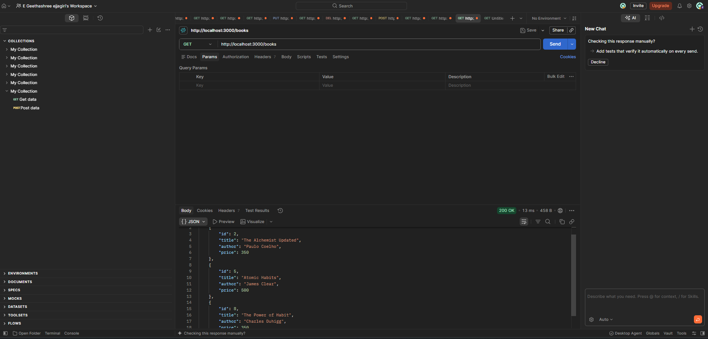

### 2. Search Books
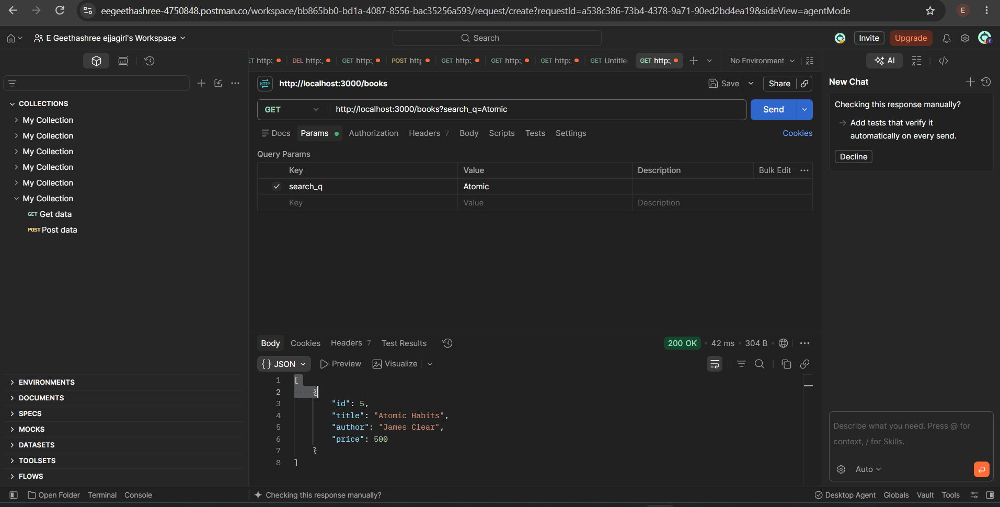

### 3. Sort Books
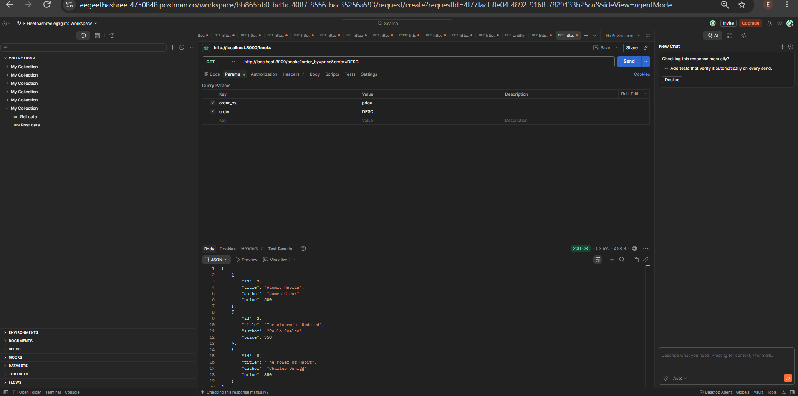

### 4. Pagination
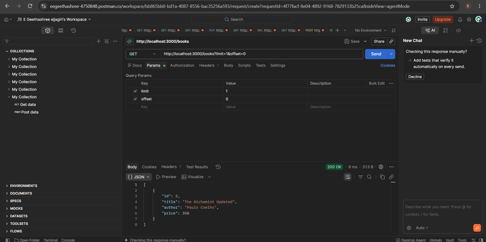

### 5. Price Filter
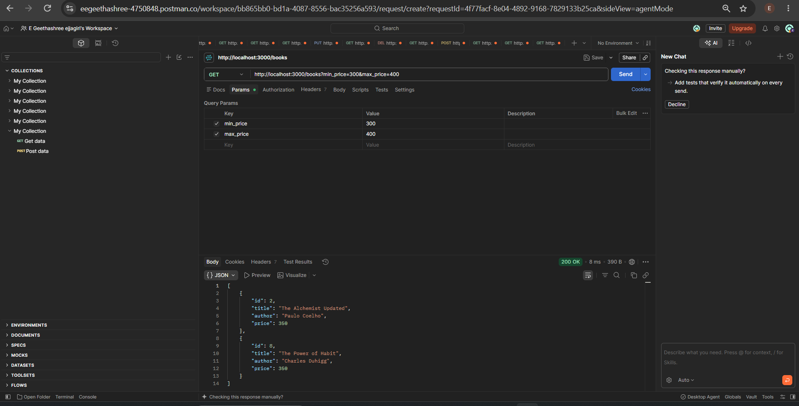

### 6. Invalid Price Filter
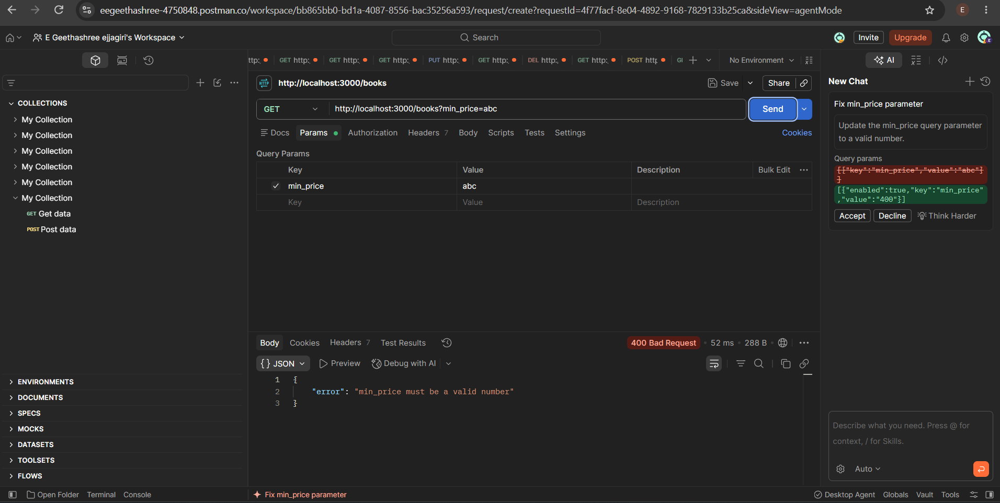

### 7. Invalid POST Request
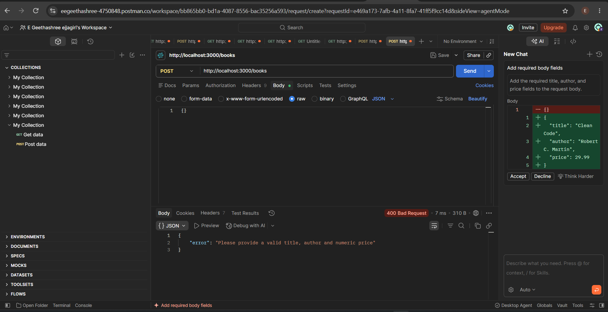

### 8. Successful POST Request
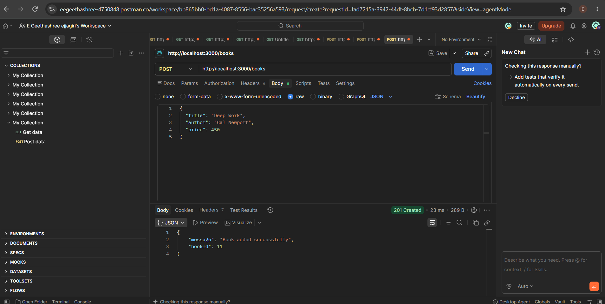

### 9. Get Book by ID
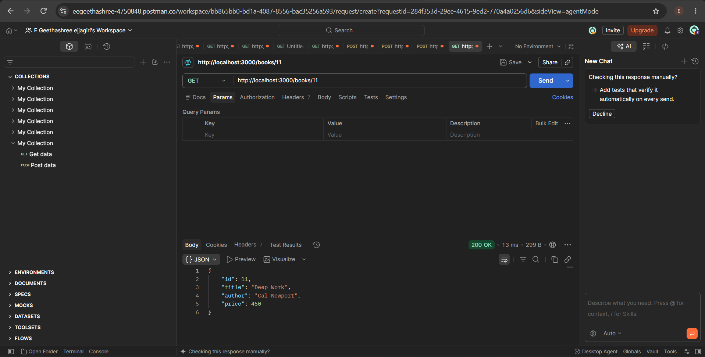

### 10. Update Book
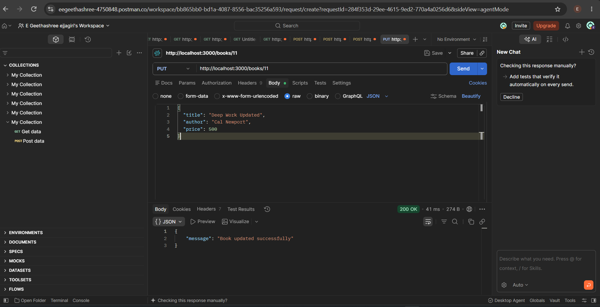

### 11. Delete Book
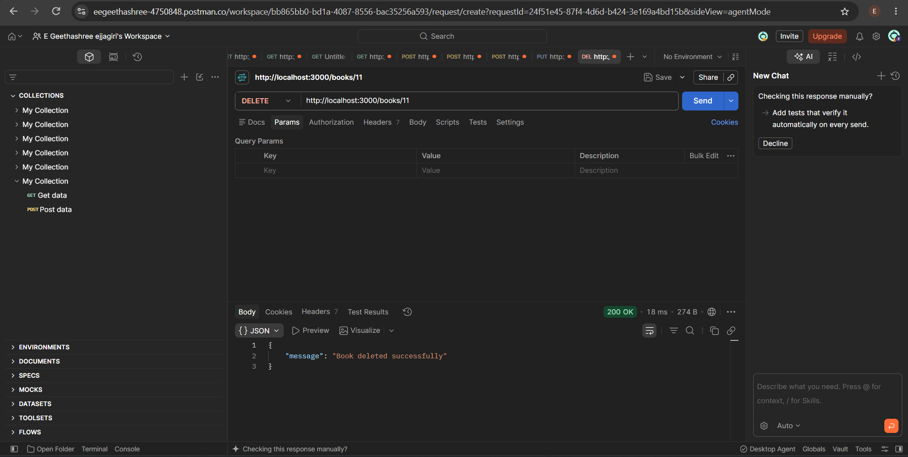

### 12. Get Non-Existing Book


### 13. Database View
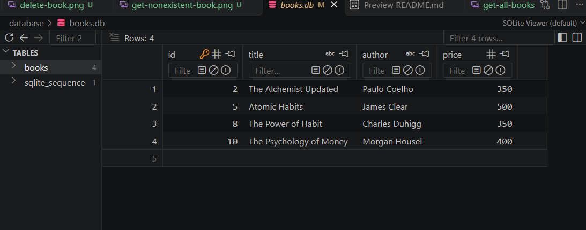

## Debugging Notes

- **EADDRINUSE:** Occurs when the requested port is already being used by another process.
- **Wrong import path:** Check that the database file path is correct.
- **No such table:** Check that the database table name is correct.
- **Missing await:** Use `await` when waiting for asynchronous database operations.

## Conclusion

In this lab, I developed a REST API using Node.js, Express.js and SQLite. I implemented CRUD operations, search, sorting, filtering, pagination, request validation and proper HTTP status codes. I also tested the API using Postman and verified the database records.